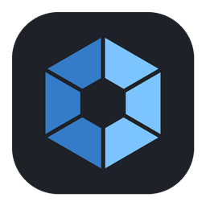
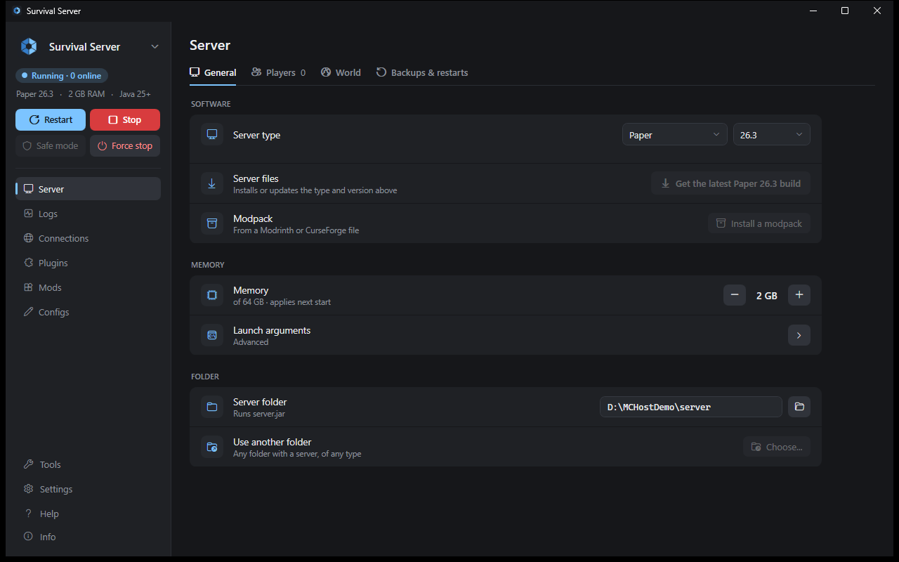
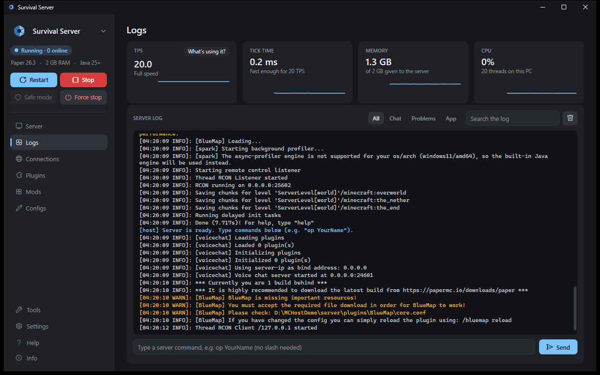
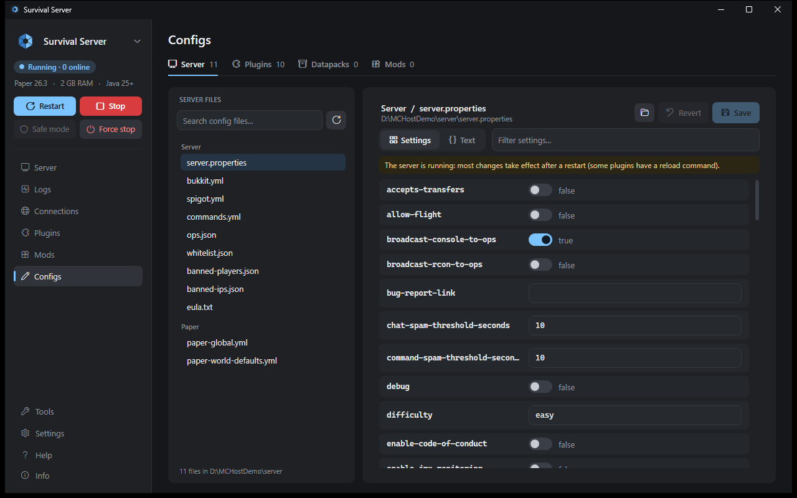
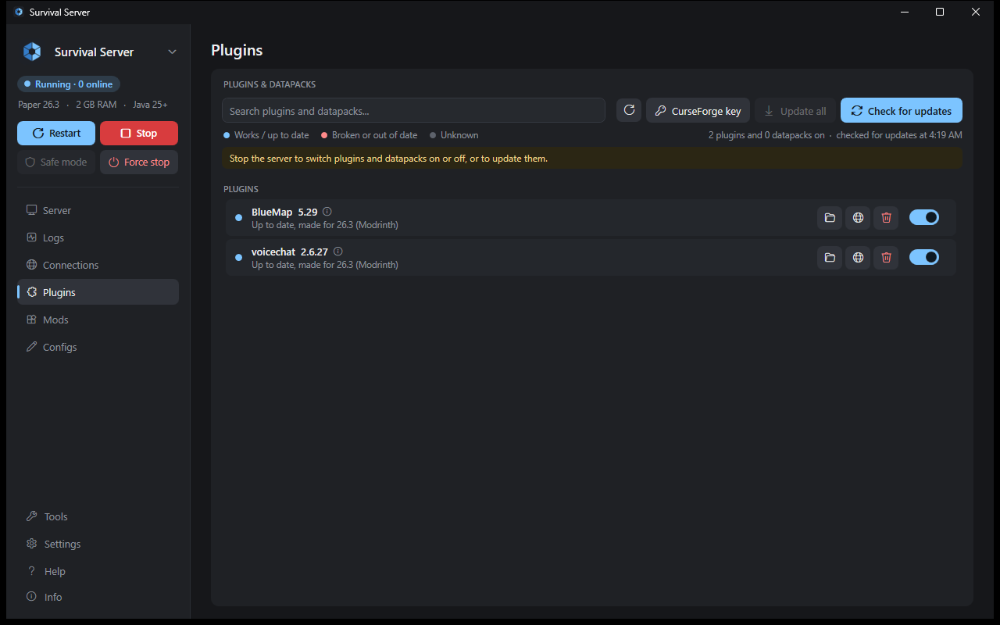
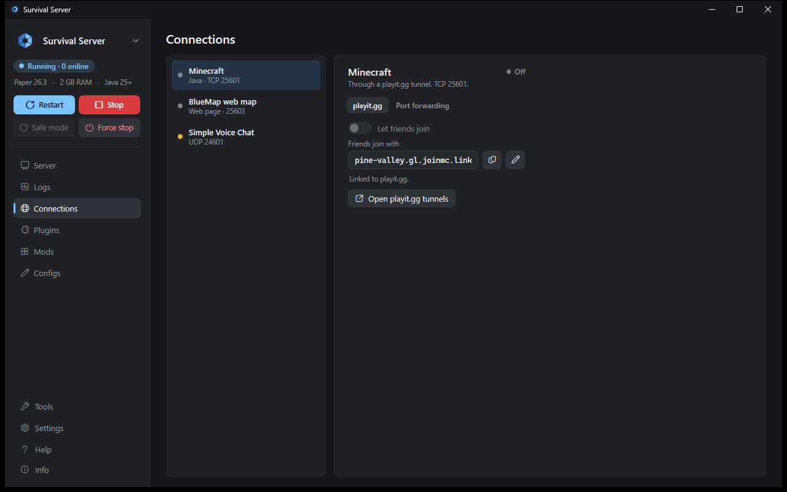
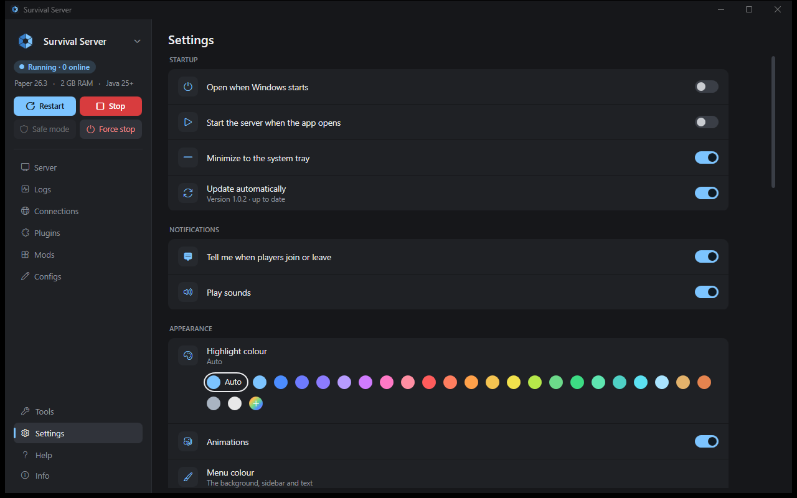
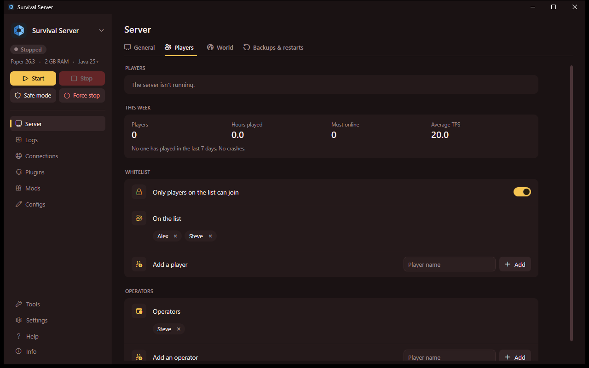

<p align="center">
  
</p>

<h1 align="center">Minecraft Self-Hoster</h1>

<p align="center">
  Run a Minecraft Java server on your own PC and let friends join, with or without port forwarding.<br>
  One Windows app, nothing to install.
</p>

<p align="center">
  <a href="https://github.com/Zapiltar-E7/minecraft-self-hoster/releases/latest"><b>Download</b></a> ·
  <a href="https://zapiltar-e7.github.io/minecraft-self-hoster/">Website</a> ·
  <a href="GUIDE.md">User guide</a>
</p>

<p align="center">
  
</p>

## Features

- **Friends can join from anywhere.** No router access? A free [playit.gg](https://playit.gg) tunnel is set up for you. Can forward ports? Pick port forwarding and skip third-party services entirely.
- **Any server type.** Paper, Fabric, Quilt, Forge, NeoForge or Vanilla, any version. Switching type or version backs up your worlds first.
- **Modpacks.** Drop in a Modrinth `.mrpack` or a CurseForge zip, and the exact loader, mods and configs are installed. Client-only mods are switched off for you.
- **Plugins and mods.** See which ones work on your version, update them from Modrinth or CurseForge, switch them on and off, and drag new ones onto the window.
- **Config editor.** Every setting in a readable grid with its description, for YAML, properties, JSON, HOCON and TOML. Comments and formatting are kept, and every save is backed up.
- **Looking after it.** Automatic world backups, scheduled restarts with in-game warnings, crash recovery, TPS and memory graphs, a live console, and a disk space view that clears out what can go.
- **Web maps and voice chat.** BlueMap, Dynmap, Simple Voice Chat, Geyser and others show up on the Connections page with what they need.
- **Several servers.** Switch between them, duplicate one, or move a whole server to another PC as a single file.
- **Your look.** 75 menu colours, and 24 highlight colours or any colour you pick.
- **Updates itself** from this repository's releases (you can switch this off).

## Screenshots

| | |
|---|---|
|  |  |
|  |  |
|  |  |

## Getting started

1. Download `MinecraftSelfHoster.exe` from the [latest release](https://github.com/Zapiltar-E7/minecraft-self-hoster/releases/latest) and put it in its own folder. The app keeps its files next to itself.
2. Run it. If something is missing, click **Set up this PC**. It downloads Java and, if you want them, the playit.gg and Cloudflare agents. Every download comes from the official source and is checked against its published checksum.
3. Pick a server type and version on the **Server** page and click **Install**, or point the app at a server folder you already have.
4. Click **Start**, then share the address from the **Connections** page with your friends.

Windows 10 or 11 (64-bit). The [user guide](GUIDE.md) explains every page.

## Building from source

Requires the [.NET 8 SDK](https://dotnet.microsoft.com/download/dotnet/8.0).

```
cd src\MinecraftHost
dotnet publish -c Release -o ..\publish
```

The result is a single self-contained `MinecraftHost.exe` in `src\publish`. `src\build.bat` does the same and copies it next to the `src` folder as `Minecraft Self-Hoster.exe`.

## Releasing

Bump `<Version>` in `src/MinecraftHost/MinecraftHost.csproj`, publish, and attach the exe to a GitHub release tagged `v<version>`. Installed copies with automatic updates on pick it up within a few hours.

## Credits

- [NVorbis](https://github.com/NVorbis/NVorbis) (MIT License, © 2020 Andrew Ward) plays Minecraft's sounds for a small easter egg. Minecraft's own sounds and textures are never included; they're read from a Minecraft installation already on the PC.
- [playit.gg](https://playit.gg), [Cloudflare](https://www.cloudflare.com) and [Eclipse Temurin](https://adoptium.net).

## License

[MIT](LICENSE)

Not an official Minecraft product. Not approved by or associated with Mojang or Microsoft.
